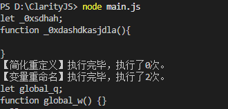
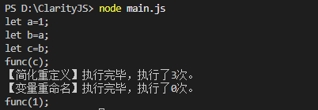
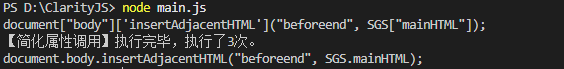
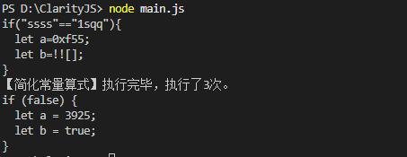
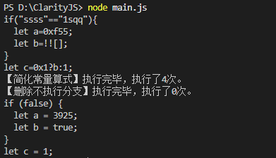
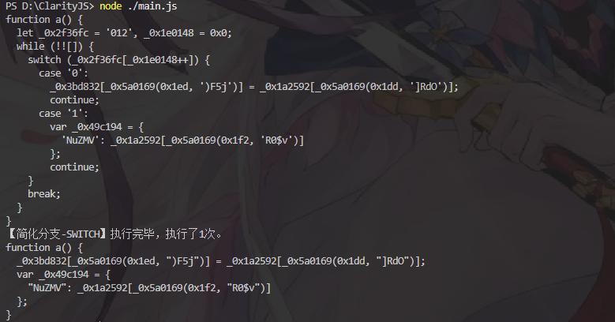

# ClarityJS
JavaScript Deconfusion Tool.

JavaScript解混淆工具，提供多种解混淆配置，支持自定义模块。

需要注意的是，本工具用了很多次eval（带有unsafe的模块）。请确认代码本身的情况或在断网的虚拟机中运行，避免执行到奇怪的地方。

## TIPS

遇见解不出来的混淆代码可以找我（在公众号重生之成为赛博女保安下留言即可，工具的更新和解混淆实战也更新在这里），如果比较有意思我会给你解一下。

## 运行

本工具需要node环境以运行。先安装依赖，使用npm i安装。

修改main.js：

- line8的数组__main__以调整要加载的模块（如果不确定要用哪些模块，使用**节2 支持解密配置**中的配置即可）
- line17的输入文件位置
- line33的输出文件位置
- line13的循环次数，默认为1

然后node main.js以运行。

## 1 支持模块

### 1.1 cj.rename <<<<

重命名混淆变量，初始配置为简化_0x开头的变量。

**这个开头可以通过cj.rename.startwith(str)修改。**

!! 注意：这个模块需要在解混淆尽可能的后期调用。由于混淆程序一般会创建非常多个变量->在前期调用这个函数很有可能会卡死。

### 1.2 cj.redefined >>>>

简化重定义，最好在一开始就调用。

### 1.3 cj.propertyclear

简化字典型调用如a["b"]["c"]。

### 1.4 【unsafe】 cj.constclear

简化永真、永假、十六进制、复杂化常量。

### 1.5 【unsafe】 cj.trimly_if <<< cj.constclear

删除永远不会执行的部分，如if的不执行分支和三目运算符的不执行分支。

!! 强烈建议在cj.constclear之后调用。

### 1.6 cj.manual_jsjiami_main <<< cj.redefined

jsjiami【中级|高级配置】解混淆主模块。

需要手动补充前几个函数的内容，直接复制粘贴在这个代码里就可以，判断方法和依赖在我文章里有写，详见2.1节。

### 1.7 cj.objectrestore

简化对象引用式混淆，也就是将代码和函数放在object里的混淆。

### 1.8 cj.trimly_switch <<< cj.constclear

还原OLLVM式平坦控制流-switch形式。

!! 强烈建议在cj.constclear之后调用。

## 2 支持解密配置

### 2.1 manual | jsjiami.com.v7【中级配置】

详情请看：[某游戏无良辅助插件逆向分析与代码还原实践](https://xz.aliyun.com/news/18778)
main=[cj.redefined,cj.manual_jsjiami_main,cj.constclear,cj.propertyclear,cj.trimly_if]。请注意先修改manual插件内容。

### 2.2 JSFuck

https://jsfuck.com/

详情请看：[How to fuck JSFuck](https://forum.butian.net/share/4561)
main=[cj.constclear,cj.propertyclear] 直接调用。请注意先修改manual插件内容。

### 2.3 manual | jsjiami.com.v7【高级配置】

详情请看：https://nccsec.cn/myTopic/detail?id=pKW2xdTj8gE
main=[cj.redefined,cj.manual_jsjiami_main,cj.objectrestore,cj.constclear,cj.propertyclear,cj.trimly_if,cj.trimly_switch]。请注意先修改manual插件内容。
